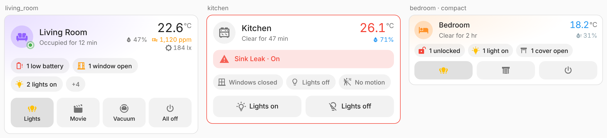
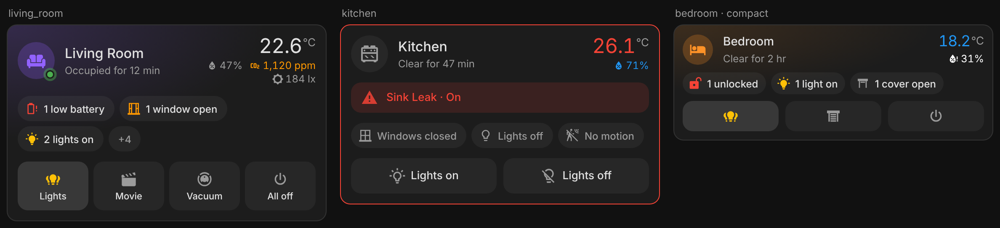
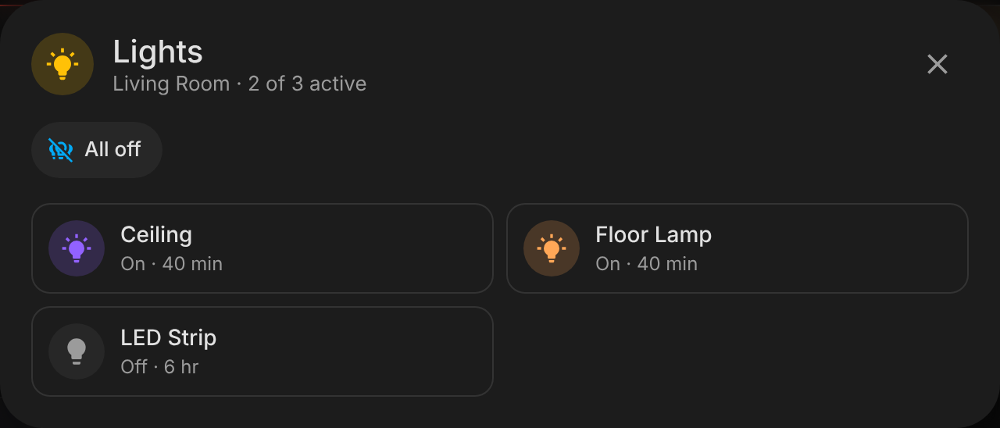
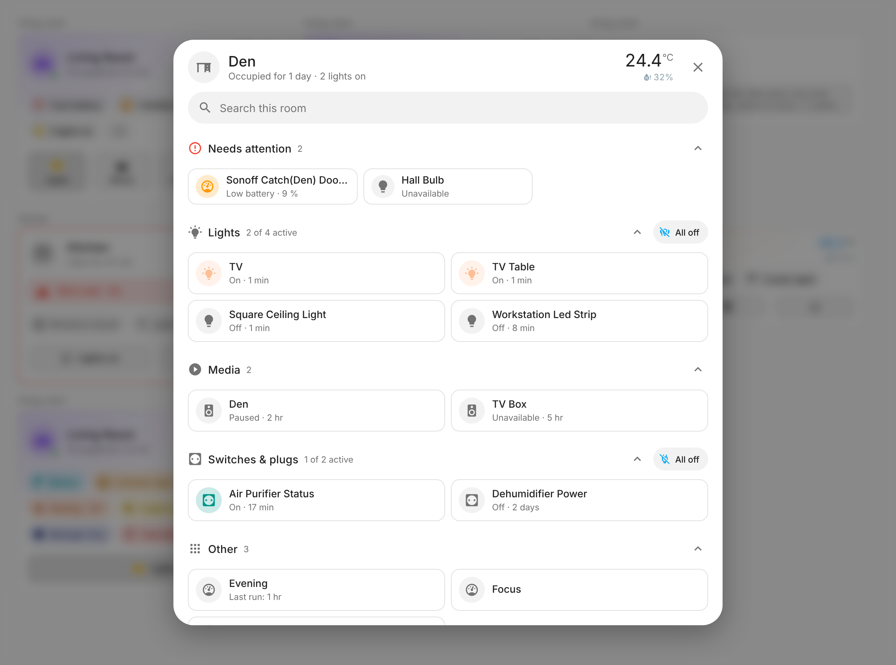

# Area Pulse Card

[](https://hacs.xyz)

A modern, area-aware dashboard card for Home Assistant. Pick an area and it shows everything that matters about that room at a glance — presence and how long it's been occupied, temperature and humidity, open doors and windows, safety alerts, what's playing, low batteries — plus a row of quick actions (lights, covers, scenes, "vacuum this room", all off).

It is built to sit next to the built-in Tile and Area cards without looking out of place: it uses `ha-card`, your theme's variables and Home Assistant's colour tokens, opens the native more-info dialogs, and hands every action to Home Assistant's own action handler (so confirmations, `navigate`, `perform-action`, etc. behave exactly like the core cards).






## Features

- **Zero config** — select an area; entities are discovered from the entity and device registries (device → area inheritance included, hidden and config entities skipped).
- **Label filter** — an area with hundreds of entities? Tag the few that matter with a Home Assistant label and tell the card to show only those (or to hide everything carrying another label). See [Filtering by labels](#filtering-by-labels).
- **Presence first** — occupancy/presence sensors (mmWave etc.) drive an "Occupied for 12 min / Clear for 2 h" line and a live presence dot; falls back to motion sensors when the room has no presence sensor.
- **Main light on the area icon** — tap the icon to toggle the room's main light, hold for its dialog. The icon and the ambient glow take the light's actual colour (RGB, colour temperature, hue/saturation or xy) and the glow scales with brightness; a light without a usable colour (a template light, a dimmer) glows in the theme's "on" colour. Auto-detected (the only light, or one named ceiling/main/κεντρικό…), or set `main_light`. Lights on a relay: set the relay's `switch` (or an `input_boolean`) as `main_light`, and it glows and toggles the same way.
- **Climate at a glance** — uses the area's own temperature/humidity sensor setting when present, otherwise the median of all sensors (same rule as the core area card). Outside the comfort band, temperature turns blue (cold) or red (warm) and humidity white (dry) or blue (humid). On light themes "dry" uses a pale blue-grey, because white text is invisible on a white card. All four colours are configurable. With the [Pulse theme](https://github.com/zacharatos/pulse-theme), the card uses its calmer palette and comfort colours.
- **Calm status chips** — motion, doors and windows, heating/cooling, lights, smart plugs and switches, fans, covers, locks, media (shows the track title) and low batteries. The card face shows the three that matter most (problems, then what's open, then lights, climate and media) and a "+N" chip opens the room popup with the rest; with exactly four, all four show. Only what's going on takes a place: "Doors closed"-style chips only fill free places, and a quiet room shows no chips at all. Colour is kept for what needs a look: open doors and windows in orange, problems (low battery, unlocked, alerts) in red, lights that are on in gold; everything else stays neutral, and only the icon is coloured. `max_chips` changes the cap (`0` shows every chip, in two rows), `chip_colors: category` brings back one colour per kind of device.
- **Room popup** — tap the card and a popup lists everything in the room, ordered by usefulness: what needs attention, then lights, climate, media and other controls, then presence and openings, then sensors as compact value cards. Search, collapsible sections, "All off" per section, a one-column bottom sheet on phones, and it honours your label filter. See [Room popup](#room-popup).
- **Group popup** — tapping a chip that covers several entities (e.g. "2 lights on") opens a popup with a native Home Assistant tile per entity, brightness slider included for dimmable lights, plus an "All off / All on" (or open/close all, pause all) button. Opening an entity's dialog from the popup steps it aside and brings it back when you close the dialog. On phones the popup is a bottom sheet. A chip with a single entity opens its more-info dialog directly.
- **Safety alerts** — moisture, smoke, gas, CO, safety, problem, tamper: a red banner as soon as one trips (its icon blinks a few times, then stays still), and the card's edge turns red when your theme draws one.
- **Extra readings** — optional air quality (AQI, CO₂, PM1, PM2.5, PM10, VOC, CO, NO₂, ozone and the rest of Home Assistant's air-quality classes), illuminance, pressure, power (summed), energy, noise, shown small next to the humidity under the temperature. AQI (101/151), CO₂ (1000/1500 ppm), PM2.5 (12/35 µg/m³) and PM10 (55/155 µg/m³) turn orange or red when out of range; everything else stays neutral. A sensor with no device class (a radon level, a purifier's own reading) can be added by entity with `sensor_entities`.
- **Room modes** — optional: point `mode_entity` at a dropdown helper (`input_select` or `select`) and the card gets a row of mode buttons (normal, cooking, movie, bedtime…), drawn and behaving like Home Pulse Card's house modes: the current mode lit, names or icons only, and a second tap on the lit mode goes back to `mode_default`. What a mode does stays in your automations.
- **Quick actions** — presets or any entity / any HA action, with tap, hold and double-tap.
- **Ambient cues** — light-coloured glow while lights are on, optional area picture blended into the background. The presence dot pings once when someone arrives; nothing loops. Transitions follow the [Pulse theme](https://github.com/zacharatos/pulse-theme)'s motion tokens when it's installed, and blinking stops with "reduce motion".
- **Sections-ready** — `getGridOptions` for the sections view, container queries for narrow columns, a `compact` layout.
- **Visual editor** — built on HA's own `ha-form` selectors; YAML optional.
- **Localised** — English and Greek; numbers, units and relative times use your HA locale.

## Installation

Area Pulse Card ships in the **[Pulse Cards](../../README.md#installation)** bundle with the rest of the family: one HACS download and one dashboard resource for all of them. Follow the steps there.

Requires Home Assistant **2025.7+** (registry data on the frontend, colour tokens). The `vacuum_area` preset needs **2026.3+** and a vacuum whose segments are mapped to areas.

## Configuration

Minimal:

```yaml
type: custom:area-pulse-card
area: living_room
```

Full example:

```yaml
type: custom:area-pulse-card
area: living_room
name: Living
icon: mdi:sofa
color: light-blue            # HA colour token or any CSS colour
layout: default              # default | compact
show_picture: true
show_inactive: false         # also show "Windows closed", "Lights off", ...
chip_colors: state           # state | category (one colour per kind of device)
max_chips: 3                 # chips on the face, the rest behind "+N"; 0 = all
main_light: light.living_room_ceiling   # optional; auto-detected
colors:
  temperature_low: blue
  temperature_high: red
  humidity_low: white
  humidity_high: blue
temperature_entity: sensor.living_room_temperature
comfort_temperature: { min: 20, max: 24 }
comfort_humidity: { min: 40, max: 60 }
sensor_classes: [carbon_dioxide, illuminance]
sensor_entities: [sensor.living_room_radon]   # readings by entity, device class or not
mode_entity: input_select.living_room_mode   # room modes, off when unset
mode_default: Normal
show_mode_names: true
groups: [alerts, motion, doors, windows, climate, lights, switches, media, batteries]
top_groups: [motion, doors, windows]   # only with max_chips: 0
exclude_entities: [binary_sensor.living_room_tv_motion]
label_filter:
  include: [Living room card]   # label name or ID
  exclude: [Hidden]
battery_threshold: 20
tap_action:
  action: navigate
  navigation_path: /dashboard-home/living-room
actions:
  - preset: lights_toggle
  - entity: scene.movie_night
    name: Movie
    icon: mdi:movie-open
  - preset: vacuum_area
    entity: vacuum.roborock
  - preset: everything_off
```

### Card options

| Option | Type | Default | Description |
| --- | --- | --- | --- |
| `area` | string | **required** | Area ID. |
| `name` / `icon` | string | area's | Override the area name / icon. |
| `color` | string | `primary` | Accent for the occupied state and plain entity actions. |
| `layout` | `default` \| `compact` | `default` | Compact shrinks everything and uses icon-only inactive chips and actions. |
| `show_picture` | bool | `true` | Blend the area picture into the card background. |
| `room_popup` | bool | `true` | Tapping the card header opens the [room popup](#room-popup). Set `false` to turn it off. A `tap_action` you configure always wins. |
| `show_inactive` | bool | `false` | Show groups with nothing active ("Doors closed"). With the chip cap they only fill places nothing active needs, and never count towards "+N". |
| `chip_colors` | `state` \| `category` | `state` | `state`: neutral chips, colour only on the icon of what needs a look (open: orange), problems (alerts, low battery, unlocked: red) and lights (gold). The room popup's section icons follow suit: neutral, red for "Needs attention". `category`: one colour per kind of device, with tinted text and background, and coloured section icons (the original look). |
| `max_chips` | number | `3` | Chips on the card face. The most important active ones win (problems, open, lights, climate, media, the rest) and a "+N" chip opens the room popup; one chip over the cap is shown instead of "+1". `0` shows every chip in the order of `groups`, in two rows (`top_groups`). Without the room popup every chip is shown. |
| `main_light` | entity | auto | Light the area icon toggles and whose colour tints the icon and glow. Can also be a `switch` or `input_boolean`, for lights on a relay: it then glows in the theme's "on" colour. Only lights are ever auto-detected. |
| `link_main_light` | bool | `true` | Set `false` to keep the area icon passive. |
| `colors` | map | see below | `temperature_low` (blue), `temperature_high` (red), `humidity_low` (white; pale blue-grey on light themes), `humidity_high` (blue). HA colour tokens or CSS colours. |
| `temperature_entity` / `humidity_entity` | entity | area setting → median | Explicit climate sensors. |
| `comfort_temperature` / `comfort_humidity` | `{min,max}` or `[min,max]` | `19–25 °C` (`68–76 °F`) / `35–65 %` | Comfort band used for colouring. |
| `sensor_classes` | list | `[]` | Extra readings by device class: `illuminance`, the air-quality classes `aqi`, `carbon_dioxide`, `pm1`, `pm25`, `pm10`, `volatile_organic_compounds`, `volatile_organic_compounds_parts`, `carbon_monoxide`, `nitrogen_dioxide`, `nitrogen_monoxide`, `nitrous_oxide`, `ozone`, `sulphur_dioxide`, and `pressure`, `power`, `energy`, `sound_pressure`. Shown in the climate block on the right, next to the humidity (they wrap onto a second line when there are several), never as chips. AQI, CO₂, PM2.5 and PM10 are coloured when out of range. |
| `sensor_entities` | list | `[]` | Extra readings by entity: any numeric sensor, with or without a device class (a radon level). Shown after the `sensor_classes` readings, with the sensor's own icon. Always used, label filter or not. |
| `mode_entity` | entity | none | Room modes: an `input_select` or `select`; one button per option, the current one lit. A tap selects the option. Off unless set (a room's mode selector is never guessed). |
| `modes` | list | from the options | Optional, YAML only: rename, reorder, pick icons and colours, or run a scene or script instead of an option. Each item: `option`, `name`, `icon`, `color`, `entity`, `tap_action`, `hold_action`, the same as Home Pulse Card's `modes`. |
| `show_mode_names` | bool | `true` | `false` draws the mode buttons as icons only (the name stays the tooltip). The `compact` layout always shows icons only. |
| `mode_default` | string | none | The option that means "normal": it gets no button, a second tap on the lit mode selects it, and while it is current no mode is lit. |
| `groups` | list | all | Which status chips to show, in order: `alerts`, `motion`, `doors`, `windows`, `climate`, `lights`, `switches`, `fans`, `covers`, `locks`, `media`, `batteries`. |
| `top_groups` | list | `motion, doors, windows` | With `max_chips: 0`: groups placed in the first chip row; every other group goes in the second row. |
| `alert_classes` | list | `moisture, smoke, gas, carbon_monoxide, safety, problem, tamper` | Binary-sensor device classes treated as alerts. |
| `presence_entities` | list | auto | Force which entities define presence (e.g. a template or `input_boolean`). |
| `exclude_entities` | list | `[]` | Ignore these entities everywhere. |
| `label_filter` | map | none | Only show entities (or devices) carrying certain Home Assistant labels. See [Filtering by labels](#filtering-by-labels). |
| `battery_threshold` | number | `20` | Battery % considered low. |
| `tap_action` / `hold_action` / `double_tap_action` | action | none | Standard HA actions for the header. |
| `actions` | list | `[]` | Quick actions, see below. |

### Room popup

Tap the card header (not the main-light icon, which still toggles the light) and a popup opens with everything in the room. It is laid out for use, not as a dump of tiles:

1. **Needs attention** — safety alerts that tripped, low batteries and unavailable entities, so a dead bulb or a leaking sensor is the first thing you see.
2. **Controls** — lights, climate, media, covers, locks, fans, switches and anything else you can act on (scenes, scripts, vacuums), as native Home Assistant tiles with the control that fits (a brightness slider beside a light's name, playback buttons for media). Active things come first, and each section with a bulk action has an **All off** (or open/close all, pause all) button.
3. **Presence & openings** — motion, occupancy, doors, windows and other binary sensors as compact rows, what is active first.
4. **Sensors** — read-only values as dense cards (value large, name small). Temperature and humidity use your comfort colours, CO₂ and PM2.5 turn orange or red when they should. Names lose the area and device prefix ("Sonoff Temperature(LR) Humidity" becomes "Humidity"), and when two cards would read the same the device name is shown as a caption.

Things worth knowing:

- It follows `label_filter`, so an area with hundreds of entities opens a sheet with only the ones you chose.
- Long sections show the first eight and a **Show N more** button. A search box appears when there are more than twelve entries; it matches names and entity IDs.
- Sections can be collapsed. The order is fixed when the popup opens, so nothing jumps under your finger while you drag a slider.
- On phones it is a nearly full-height bottom sheet with one column of controls and two columns of sensor values.
- Opening Home Assistant's own dialog for an entry (tap a sensor card or status row, or a tile's more-info) steps the popup aside; closing the dialog brings it back where you left it.
- Configure `tap_action` (for example `navigate`) to make the header do something else, or set `room_popup: false`.
- `features_position: inline` for the light slider needs a recent Home Assistant; older versions draw the slider below the name.

### Filtering by labels

Real areas collect dozens or hundreds of entities: every diagnostic sensor, every bulb in a group, every integration helper. Labels let you choose which ones the card cares about, without listing entities one by one.

1. In Home Assistant open **Settings → Areas, labels & zones → Labels** and create a label (say *Living room card*).
2. Attach it to entities or devices (select several in **Settings → Devices & services → Entities**, then **Add label**). Labelling a *device* covers all of its entities.
3. Tell the card to use it, in the editor under **Filter by labels** or in YAML:

```yaml
type: custom:area-pulse-card
area: living_room
label_filter:
  include: [Living room card]
```

| Key | Default | Description |
| --- | --- | --- |
| `include` | none | Show only entities that carry one of these labels. A single label or a list; label **name** (`Living room card`) or label **ID** (`living_room_card`) both work. The visual editor writes IDs. |
| `exclude` | none | Hide entities that carry any of these labels. **Exclusion always wins** over `include`. Works on its own too: "everything except what is labelled *Hidden*". |
| `match` | `any` | With several `include` labels, `any` needs one of them, `all` needs every one. |
| `from_device` | `true` | Also read labels from the entity's device, so one label on a device brings in all its entities. Set `false` to look at entity labels only. |

Good to know:

- The filter applies to **everything the card derives from the area**: chips, climate readings, presence, the main light, the group popup and battery warnings. Battery sensors are separate entities, so label the *device* (with `from_device` on) and its battery warning comes along.
- The area presets (`lights_on`/`lights_off`/`lights_toggle`, `covers_*`, `fans_off`, `media_stop`, `everything_off`) act on the whole area normally, but with a label filter they act **only on the entities the card shows**, so "Lights off" never switches off lights you kept off the card.
- Entities you name explicitly (`main_light`, `temperature_entity`, `humidity_entity`, `presence_entities`, an `actions` entity) and the sensors set in the area itself are always used, label or not.
- `exclude_entities` still applies on top of the label filter.
- If no entity in the area matches, the card says so and names the labels it was looking for, rather than rendering an empty card.
- Label names are matched case-insensitively. If you rename a label in Home Assistant, the ID stays, so IDs are the safer choice in shared YAML.

### Quick actions

Each item accepts `preset`, `entity`, `name`, `icon`, `color`, `tap_action`, `hold_action`, `double_tap_action`. Anything you set overrides the preset.

| Preset | What it does |
| --- | --- |
| `lights_toggle` | Turns the area's lights off if any is on, otherwise on. Highlights while any light is on. |
| `lights_on` / `lights_off` | `light.turn_on` / `light.turn_off` targeting the area. |
| `covers_open` / `covers_close` | `cover.open_cover` / `cover.close_cover` targeting the area. |
| `fans_off` | `fan.turn_off` targeting the area. |
| `media_stop` | `media_player.media_stop` targeting the area. |
| `vacuum_area` | `vacuum.clean_area` for this area on `entity` (with confirmation). |
| `everything_off` | `homeassistant.turn_off` targeting the area (with confirmation). |

Without a preset, an `entity` button toggles the entity (scenes and scripts run, buttons press) and hold opens more-info. Or give it any `tap_action`:

```yaml
- name: Goodnight
  icon: mdi:weather-night
  tap_action:
    action: perform-action
    perform_action: script.goodnight
    data: { area: bedroom }
```

## Development

Everything is built and tested from the repository root: see [Development](../../README.md#development). This card's harness is `cards/area-pulse-card/test/harness.html`, with `?dark=1`, `?lang=el`, `?helpers=1` (stubs HA's card helpers for the native-tile popup path), `?rgb=255,120,40` (the main light's colour), `?theme=pulse|glass|tonal`.

## License

MIT, see [LICENSE](../../LICENSE).
