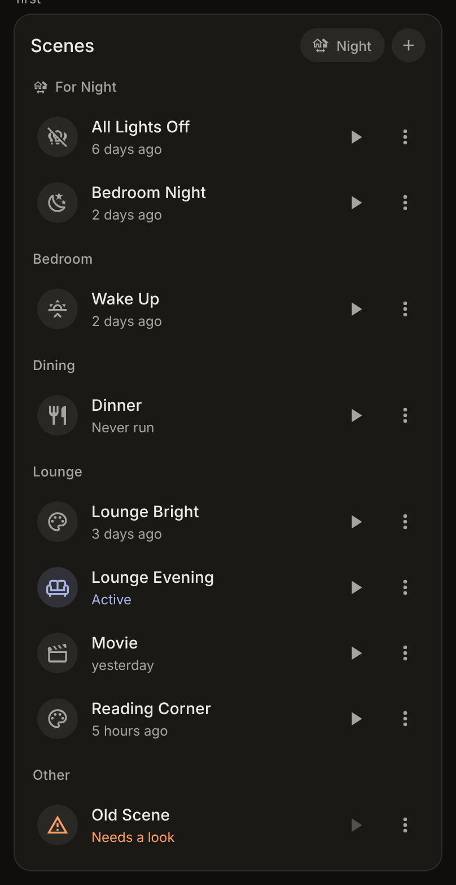
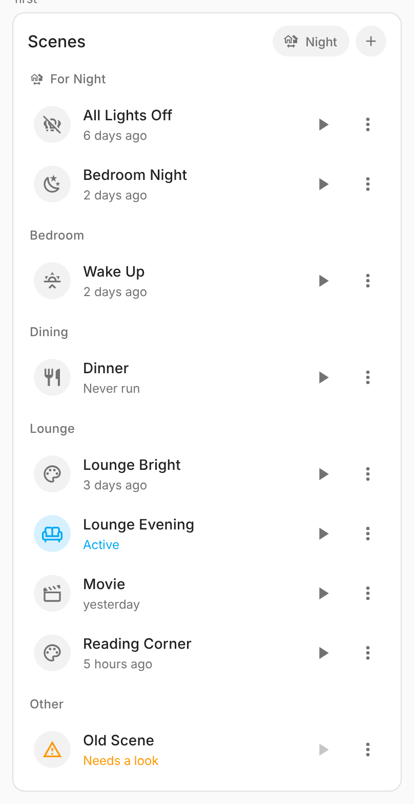
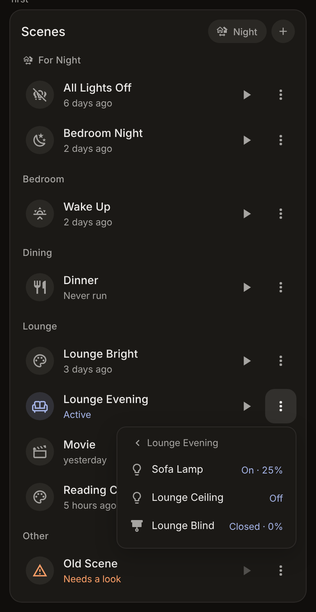

# Scene Pulse Card

[](https://github.com/hacs/integration)

Your Home Assistant scenes in one calm list. See which scene is really on right now, run one with a tap, undo it if it wasn't what you wanted, and look inside, edit or re-capture a scene without leaving the dashboard. If you use a house mode selector (like Home Pulse Card's), the scenes for the current mode come first. Part of the Pulse family; it reads the Pulse theme's tokens and follows any other theme too.

| Dark (Pulse) | Light |
| :-: | :-: |
|  |  |

## Features

- **One row per scene**: icon, name, when it last ran, a run button and a menu. About half the height of a tile card with an *Activate* feature.
- **Active now**: for scenes made in the UI, the card compares what the scene sets with how things are, and lights the scenes that match. For other scenes, the one that ran last stays active until something it set changes.
- **Undo**: just before a run, the card remembers how the scene's entities were. The toast after the run has an *Undo* button that puts them back, an *Undo* chip waits in the card's header for two minutes, and the scene's ⋯ menu keeps offering it until the next run.
- **House mode first**: give scenes a label named like a mode option (for example *Night*). While the house is in that mode, those scenes sit in their own section at the top, and the header shows the mode.
- **Labels or a list**: show every scene, a list you pick, every scene with a label (new ones appear on their own), or a mix; `exclude` hides some.
- **What it sets**: the menu lists every entity the scene sets and its target (*On · 25%*, *Closed · 0%*). Targets that already match are highlighted.
- **Update from now** (admins): set the room the way you like, then re-capture the scene from the current states with two taps.
- **Edit** and **New scene** (admins) open Home Assistant's scene editor.
- **Ask first** for big scenes (`confirm`), **fade** lights in (`transition`), **group** by area or label.
- English and Greek, light and dark, visual editor.



## Installation

Scene Pulse Card ships in the **[Pulse Cards](../../README.md#installation)** bundle with the rest of the family: one HACS download and one dashboard resource for all of them. Follow the steps there.

## Configuration

```yaml
type: custom:scene-pulse-card
```

That shows every scene in the house. Everything else is optional:

| Option | Default | What it does |
| :- | :- | :- |
| `title` | `Scenes` | Header title. `""` hides it. |
| `entities` | | Scenes shown first, in this order. |
| `label` | | A label id, or a list. Every scene with one of them is shown too, by name. |
| `exclude` | | Scenes never shown. |
| `group_by` | `none` | `area` or `label`: section titles. |
| `confirm` | | Scenes that ask before they run. |
| `transition` | | Seconds for lights to fade into the scene. |
| `mode_entity` | discovered | The house mode selector (`input_select` or `select`). By default the one called `…house_mode` or `…home_mode`, like Home Pulse Card. `none` turns the mode link off. |
| `undo` | `true` | `false` hides Undo. |

```yaml
type: custom:scene-pulse-card
title: Living room
label: living_room_scenes
entities:
  - scene.movie
group_by: area
confirm:
  - scene.all_lights_off
transition: 2
```

## House modes

The card finds your house mode selector the same way Home Pulse Card does. To tie scenes to a mode, create a label with the same name as the mode option (*Night* for the option *Night*; case, accents and spaces don't matter) and give it to those scenes. When the house switches to *Night*, a **For Night** section with those scenes appears at the top. Tapping the mode chip in the header opens the selector.

## How "Active" works

- **Scenes made in the UI** (they have an id): the card reads the scene's stored targets (admins only, a Home Assistant rule) and compares each entity's state, brightness, colour temperature, position, temperature and a few more with how it is now. Small differences (a light at 49% instead of 50%) still count as a match. Several scenes can be active at once when they agree.
- **Other scenes**, and for users who aren't admins: the scene that ran last is active until one of its entities changes after it settles.

## Undo

Undo uses Home Assistant's own `scene.create` with `snapshot_entities`, under the id `scene_pulse_undo`. It remembers the entities the scene sets: the ones a scene made in Home Assistant lists. Scenes from integrations (Hue and the like) don't say which entities they set, so for those the card remembers the lights, switches, fans, covers, climate and media players in the scene's area; a scene from an integration with no area has no Undo. It is one shared snapshot, kept in memory until Home Assistant restarts; the last run from any dashboard wins. It never shows in the card.

## Development

Everything is built and tested from the repository root: see [Development](../../README.md#development). This card's harness is `cards/scene-pulse-card/test/harness.html`, with `?dark`, `?lang=el`, `?theme=pulse|glass|tonal`, `?menu`, `?show`, `?user`.

## License

MIT, see [LICENSE](../../LICENSE).
