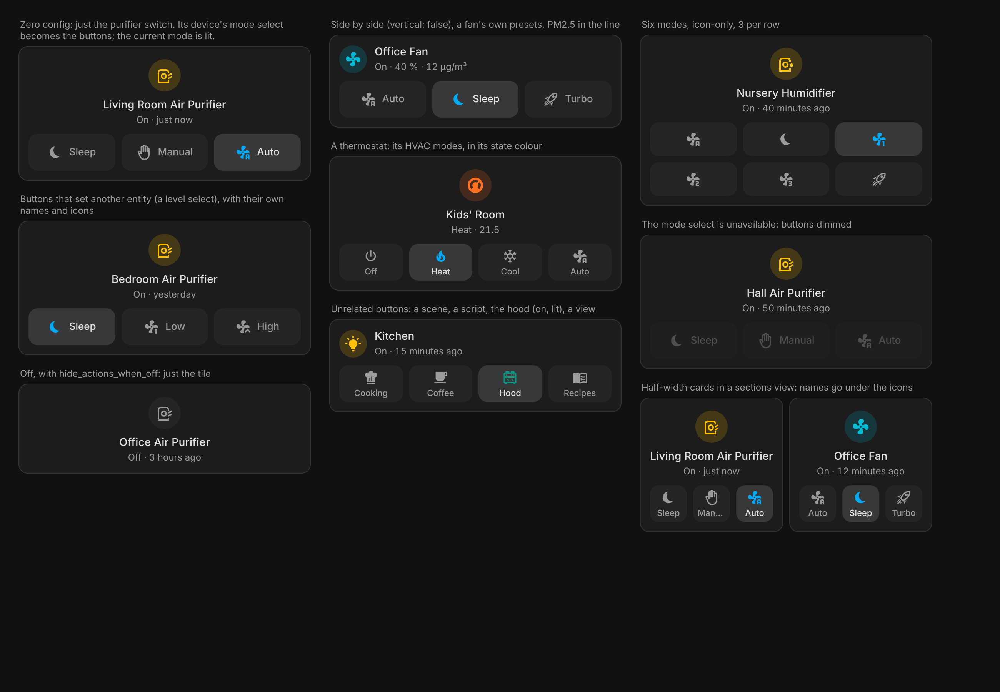
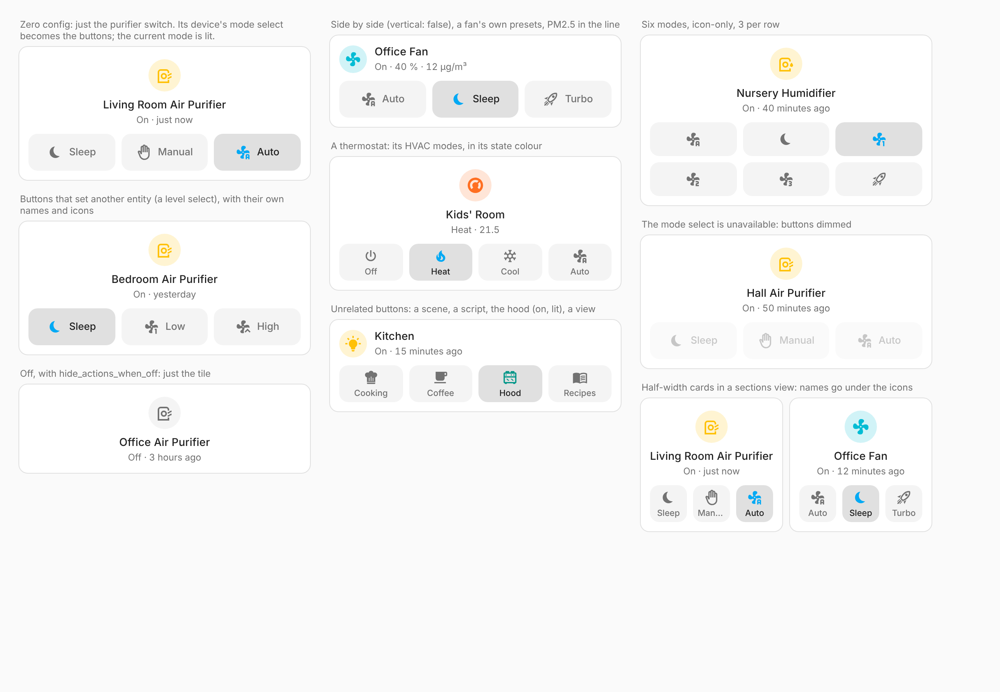

# Tile Pulse Card

[](https://hacs.xyz)

One entity drawn like a tile, with a row of buttons under it. The buttons can set the entity's own modes, set an option on **another** entity (the mode select of an air purifier, say), run a scene or script, toggle something else, or do any Home Assistant action. The button that matches the current state is lit, so the row also tells you what mode things are in.

It replaces the "vertical stack in card + tile + a row of buttons" recipe with one card that knows which button is active, works with zero config for the common case, and looks like the rest of the Pulse family ([Area Pulse](../area-pulse-card/README.md), [Home Pulse](../home-pulse-card/README.md), [Pulse Theme](https://github.com/zacharatos/pulse-theme)) and like Home Assistant's own tile card.




## Features

- **Zero config for devices with modes.** `entity: switch.purifier` alone: if the purifier's device has one mode select (`Sleep`, `Manual`, `Auto`…), each option becomes a button. A fan's own presets, a thermostat's HVAC modes, a humidifier's modes, a water heater's operation modes and a media player's sources work the same way when they are the main entity.
- **More than one row.** `button_rows` adds rows under the first, each with buttons from its own entity: the purifier's mode on top, its fan level under it.
- **Buttons for anything.** Set an `option` on any entity (select, input_select, fan preset, climate HVAC mode or preset, humidifier mode, water heater mode, media source, a number or input_number value), toggle an entity, run a scene, script or button, or give a button any `tap_action`, `hold_action` and `double_tap_action`, with HA's own confirmation.
- **The current one is lit.** A stronger neutral fill with the colour on the icon (the family rule), and `aria-pressed` for screen readers. Option names are shown the way Home Assistant translates them; icons are guessed from the names in English and Greek (sleep, auto, manual, low, high, turbo, eco, heat, cool…).
- **Answers at once.** A tapped mode lights up straight away and its icon breathes until the device confirms (at most a few seconds), so a slow purifier never feels like a missed tap.
- **A native-looking tile.** Icon above the name (default) or beside it (`vertical: false`), the icon in Home Assistant's state colour while on, tap for more-info, tap the icon to toggle (only for things that are safe to toggle: never locks, covers or alarms). The line under the name shows the state and how long ago it changed by default, and can show attributes or other entities (PM2.5 next to the purifier's state).
- **Quiet when it should be.** `hide_actions_when_off: true` hides the buttons while the main entity is off. Buttons whose entity is unavailable are dimmed and do nothing.
- **Fits any width.** Buttons balance into rows (5 on 4 columns → 3 + 2); on narrow cards the names go under the icons. Icon-only with `show_names: false`.
- **Pulse theme ready.** Every colour, radius and motion reads the shared `--pulse-*` tokens first, then your theme's variables.
- **Visual editor** on HA's own form controls, with a reorderable button list and a "Customise these buttons" shortcut that writes the automatic buttons out for you. **English and Greek.**

## Installation

Tile Pulse Card ships in the **[Pulse Cards](../../README.md#installation)** bundle with the rest of the family: one HACS download and one dashboard resource for all of them. Follow the steps there.

Requires Home Assistant **2025.7+**.

## Configuration

Minimal:

```yaml
type: custom:tile-pulse-card
entity: switch.living_room_purifier
```

| Option | Default | What it does |
| :- | :- | :- |
| `entity` | **required** | The main entity, drawn as the tile. |
| `name`, `icon` | the entity's | Override the name and icon. |
| `color` | HA's state colour | Icon colour while the entity is on (`amber`, `teal`, `#ff9800`…). |
| `vertical` | `true` | Icon above the name. `false`: icon left, text right, like the native tile. |
| `state_content` | `[state, last_changed]` | The line under the name: `state`, `last_changed`, `last_updated`, any attribute name, or another entity id (its state). |
| `tap_action` / `hold_action` / `double_tap_action` | more-info / more-info / none | Actions on the tile. |
| `icon_tap_action` | toggle when safe, else more-info | Action on the icon. |
| `action_entity` | discovered | Where the buttons' options come from, and the target of every button with an `option`. `none` turns discovery off. |
| `actions` | one per option of `action_entity` | The buttons. An empty list (`[]`) shows none. |
| `columns` | `4` | Buttons per row (1–6). |
| `button_rows` | – | More rows of buttons under the first. Each: `action_entity` (its buttons come from this entity's options, and its buttons with an `option` set it), `actions` (its own buttons, as below), `columns` (default: the card's). |
| `show_names` | `true` | Names on the buttons. |
| `hide_actions_when_off` | `false` | Hide the buttons while the main entity is off or unavailable. |

### Buttons

| Field | What it does |
| :- | :- |
| `option` | The option to set on the button's entity (or on `action_entity`, or on the main entity). The button is lit while that option is current. For a `number` / `input_number` it is a value (`2`); one with 2–6 steps between its min and max gives one button per step on its own. |
| `entity` | The entity this button works on. Without `option`: toggles it (light, switch, fan…), runs it (scene, script, button) or opens its dialog. Lit while it is on. |
| `name`, `icon` | Default: the option's translated name and a guessed icon, or the entity's name and icon. |
| `color` | Icon colour while lit. Default: the theme's accent. |
| `tap_action`, `hold_action`, `double_tap_action` | Any HA action; overrides what the button would do. Hold opens the entity's dialog by default. |

### Discovery

Without `action_entity`, the card looks for options in this order:

1. The main entity itself, if it has 2–6 options (a fan's presets, a thermostat's HVAC modes, a select).
2. The one `select` / `input_select` with 2–6 options on the **same device** as the main entity (not hidden, not diagnostic). If there are several, a single one with "mode" or "preset" in its name wins; otherwise nothing is guessed.

Anything you set explicitly wins.

### Full example

```yaml
type: custom:tile-pulse-card
entity: switch.bedroom_purifier
state_content: [state, sensor.bedroom_pm25]
action_entity: select.bedroom_purifier_level
hide_actions_when_off: true
actions:
  - option: sleep
    name: Sleep
    icon: mdi:power-sleep
  - option: low
    name: Low
  - option: high
    name: High
    icon: mdi:fan-chevron-up
```

Two rows: the mode, then the fan level (a number from 1 to 3, one button per step):

```yaml
type: custom:tile-pulse-card
entity: switch.living_purifier          # its mode select is found on the device
button_rows:
  - action_entity: number.living_purifier_fan_level
```

Unrelated buttons on one tile:

```yaml
type: custom:tile-pulse-card
entity: light.kitchen
vertical: false
actions:
  - entity: scene.kitchen_cooking
    icon: mdi:chef-hat
  - entity: script.coffee
    icon: mdi:coffee
  - entity: switch.kitchen_hood          # lit while on
  - name: Recipes
    icon: mdi:book-open-variant
    tap_action:
      action: navigate
      navigation_path: recipes
```

## Theming

The card reads the Pulse tokens first, then Home Assistant's variables. You can also set its own variables in a theme or with card-mod:

`--tpc-accent`, `--tpc-active`, `--tpc-neutral-bg`, `--tpc-neutral-bg-hover`, `--tpc-neutral-strong`, `--tpc-radius`, `--tpc-control-radius`, `--tpc-gap`, `--tpc-pad`, `--tpc-motion-fast`, `--tpc-motion-normal`, `--tpc-motion-slow`, `--tpc-ease`.

## Development

Everything is built and tested from the repository root: see [Development](../../README.md#development). This card's harness is `cards/tile-pulse-card/test/harness.html`, with `?dark=1`, `?lang=el`, `?theme=pulse|glass|tonal`.

## License

MIT, see [LICENSE](../../LICENSE).
